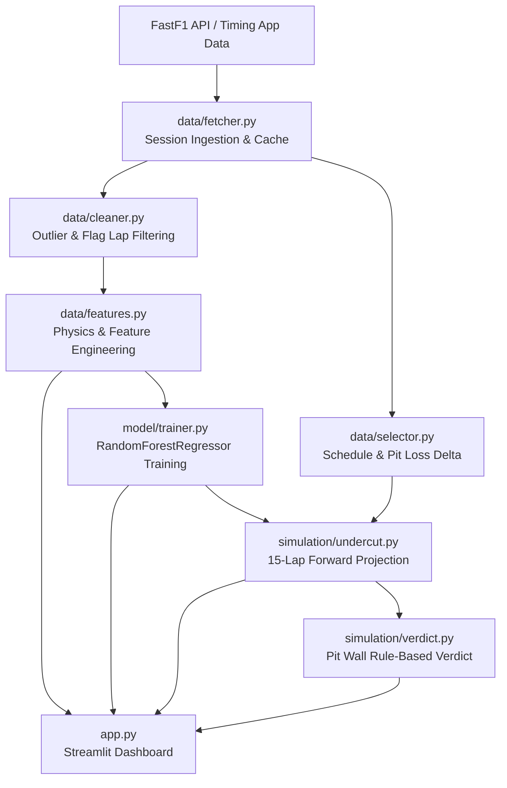

# Product Requirements Document (PRD)
## F1 Strategy Engineer: Machine Learning Tyre Degradation & Undercut Simulation Platform

---

### Document Information
- **Product Name:** F1 Strategy Engineer (`f1-early`)
- **Version:** 1.0.0 (Phases 1–5 Complete)
- **Status:** Production / Active
- **Target Users:** Race Strategy Engineers, Sim Racers, F1 Performance Analysts, Motorsport Data Enthusiasts
- **Primary Repository:** [github.com/rajat270605/f1-early](https://github.com/rajat270605/f1-early)
- **Tech Stack:** Python 3.10+, Streamlit, FastF1, Scikit-Learn, Pandas, NumPy, Plotly

---

## 1. Executive Summary & Problem Statement

### 1.1 The Strategy Challenge in Formula 1
In modern Formula 1 Grand Prix racing, pit strategy is often the decisive factor between winning and losing. A critical strategic manoeuvre is the **undercut**: pitting a following or competing driver a lap or two earlier than the rival to leverage fresh tyre grip, build a rapid delta, and jump ahead when the competitor pits later.

However, calculating the viability of an undercut in real time is intensely complex due to overlapping variables:
1. **Non-Linear Tyre Degradation:** Grip loss varies wildly depending on compound (Soft, Medium, Hard), stint length, and track temperature.
2. **Fuel Mass Effect:** Cars shed ~1.7 kg of fuel per lap (starting from ~110 kg), creating a natural lap-time reduction of ~0.03s per kg burned that masks true tyre wear.
3. **Track Evolution (Rubbering In):** Lap times naturally drop across the Grand Prix as rubber is laid down on the racing line.
4. **Pit Lane Loss Delta:** Pit delta varies widely by circuit (18s to 28s+), determining how quickly fresh tyres must pay back the pit lane transit deficit.

### 1.2 The Solution
**F1 Strategy Engineer** is an end-to-end analytics and simulation platform that ingests official telemetry and timing data via FastF1, applies physical corrections (fuel burn, track evolution, out/in-lap filtration), trains a Random Forest regression model on driver lap deltas, and runs a forward-looking 15-lap simulation to forecast crossover points and evaluate undercut viability with plain-English pit-wall verdicts.

---

## 2. System Architecture & Data Flow

---

## 3. Product Features & Implementation by Phase

### Phase 1: Data Fetching, Scheduling & Pit Lane Extraction
- **Module:** `data/fetcher.py`, `data/selector.py`
- **Capabilities:**
  - **Schedule Ingestion:** Dynamically fetches championship rounds for seasons 2018–2025 via FastF1, filtering out pre-season testing events.
  - **Local Disk Caching:** Caches API payloads in SQLite and pickle format to maximize responsiveness and prevent API rate-limiting.
  - **Weather Integration:** Syncs lap-by-lap track temperature (`TrackTemp`) from session weather data with a 30.0°C safety fallback.
  - **Pit Loss Extraction:** Computes the median pit lane transit duration across all drivers in the session via `get_pit_loss_delta()`, falling back to 22.0 seconds if timing loop data is sparse.

---

### Phase 2: Race Lap Cleaning & Feature Engineering
- **Module:** `data/cleaner.py`, `data/features.py`
- **Capabilities:**
  - **Data Cleansing (`clean_laps`):**
    - Identifies physical stints via `PitOutTime` cumulative tracking.
    - Excludes in-laps (`PitInTime.notnull()`) and out-laps (`PitOutTime.notnull()`).
    - Strips Safety Car (TrackStatus 4), Virtual Safety Car (TrackStatus 6), Red Flags (TrackStatus 5), and yellow flag sectors (only green flag `TrackStatus == 1` is preserved).
    - Removes corrupted / non-racing laps ($< 60\text{s}$ or $> 200\text{s}$).
  - **Physics & Feature Engineering (`engineer_features`):**
    - **Compound Encoding:** Ordinal numeric mapping (Soft = 1, Medium = 2, Hard = 3, Intermediate = 4, Wet = 5).
    - **Track Evolution (`track_evolution`):** Lap-by-lap field-wide median lap time capturing rubber deposition before fuel correction.
    - **Fuel Correction (`fuel_corrected_time`):** Corrects raw lap time by subtracting mass-induced penalties.
    - **Tyre Age Verification (`tyre_age`):** Per-stint chronological lap index.
    - **Target Variable (`laptime_delta`):** Normalized pace delta relative to the driver's fresh-tyre baseline (lap 1 of their first stint).

---

### Phase 3: Machine Learning Tyre Degradation Model
- **Module:** `model/trainer.py`
- **Capabilities:**
  - **Algorithm:** Scikit-Learn `RandomForestRegressor(n_estimators=100, max_depth=10, random_state=42)`.
  - **Input Features:**
    1. `tyre_age` (int)
    2. `compound_encoded` (int)
    3. `fuel_corrected_time` (float)
    4. `track_evolution` (float)
    5. `track_temp` (float)
  - **Target:** `lap_time_delta` (pace loss vs. fresh tyre baseline).
  - **Validation & Metrics:** 80/20 train/test split reporting Mean Absolute Error (MAE) and Coefficient of Determination ($R^2$).
  - **Single-Lap Inference:** `predict_lap_time(...)` allows low-overhead per-lap evaluation inside forward simulation loops.

---

### Phase 4: Forward Undercut Simulation Engine
- **Module:** `simulation/undercut.py`, `simulation/verdict.py`
- **Capabilities:**
  - **Perspective:** Evaluates strategic risk from Driver A's perspective (driver at risk of being undercut).
  - **Dynamic Compound Testing:** Simulates pitting onto any selected compound (Soft, Medium, Hard).
  - **15-Lap Forward Projection:**
    - **Stay Out Curve:** Projects pace assuming Driver A stays out on aging tyres with decaying fuel load and evolving track temperature.
    - **Pit Now Curve:** Projects pace resetting tyre age to 1, injecting `pit_loss_delta` onto Lap 1, and projecting forward 14 laps on fresh rubber.
  - **Crossover Lap Detection:** Pinpoints the exact future lap where the cumulative time of pitting and running fresh tyres undercuts staying out.
  - **Viability Threshold ($\text{Crossover} \le 3$):** Flags an immediate undercut window if the stop pays for itself within 3 laps.
  - **Cumulative Gap Evolution:** Computes the on-track pace gap between Driver A and Driver B across common clean racing laps.
  - **Natural Language Verdicts:** Formulates plain-English pit wall decisions:
    - *Immediate threat:* `"Undercut window opens on lap X. Driver B can pit now and recover the pit stop loss within 3 laps..."`
    - *Low risk:* `"No immediate undercut threat. Pit stop loss takes more than 3 laps to recover..."`
    - *Safe:* `"No undercut window detected in the next 15 laps. Driver A is safe to stay out."`

---

### Phase 5: Interactive Streamlit Dashboard
- **Module:** `app.py`
- **UI Architecture:**
  - **Sidebar Controls:**
    - Season Selector (2018–2025).
    - Grand Prix Event Selector.
    - Driver A and Driver B pickers (mutually exclusive).
    - Interactive Lap Scrubbing Slider (`Simulate undercut from lap`).
    - Compound Choice Selectbox (`Pit onto compound`).
    - Performance Metrics (`Pit loss delta`, `Model MAE`).
  - **Section 1: Tyre Degradation Chart (Plotly)**
    - Multi-stint scatter plot comparing both drivers across all laps.
    - Color-coded by official F1 compound colors: Soft (`#E8002D`), Medium (`#FFF200`), Hard (`#FFFFFF` with `#888888` border).
    - Distinct marker geometries (Driver A: filled circles; Driver B: filled diamonds).
  - **Section 2: Gap Evolution Chart (Plotly)**
    - On-track gap curve in `#00D2FF` with zero-delta horizontal guideline.
    - Automatic vertical dashed indicators marking actual pit entries (`PIT {DRIVER}`) for both competitors.
  - **Section 3: Undercut Simulation & Projection Chart (Plotly)**
    - Shows actual predicted lap times across the 15-lap simulation window.
    - Stay Out trace (`#FF6B6B`) vs. Pit Now trace (`#51CF66`).
    - Visual pit loss annotation on Lap 1 (`+{pit_loss}s pit stop`).
    - Dynamic vertical line at the exact crossover lap.
    - Context-aware alert boxes (`st.warning` / `st.info`) displaying pit wall recommendations.

---

## 4. Key Mathematical Formulations

### 4.1 Fuel Burn Correction
The mass of fuel burned per lap reduces the car's inertia and lap time:
$$M_{\text{fuel}}(L) = \max\left(0, 110 - 1.7 \cdot L\right)$$
$$\Delta t_{\text{fuel}}(L) = M_{\text{fuel}}(L) \times 0.03\text{ s/kg}$$
$$t_{\text{corrected}}(L) = t_{\text{lap}}(L) - \Delta t_{\text{fuel}}(L)$$

### 4.2 Degradation Target Variable
$$\text{Baseline}(D) = \min_{L \in \text{Stint } 1} t_{\text{corrected}}(D, L)$$
$$\text{lap\_time\_delta}(D, L) = t_{\text{corrected}}(D, L) - \text{Baseline}(D)$$

### 4.3 Cumulative Undercut Crossover Condition
For simulation focus lap $L_0$ and forecast horizon $k \in \{1, \dots, 15\}$:
$$T_{\text{stay\_out}}(k) = \sum_{i=1}^{k} \hat{t}_{\text{stay\_out}}(L_0 + i)$$
$$T_{\text{pit\_now}}(k) = \Delta t_{\text{pit\_loss}} + \sum_{i=1}^{k} \hat{t}_{\text{pit\_now}}(i)$$
$$\text{Crossover Lap } k^* = \min \left\{ k \in \{1, \dots, 15\} \mid T_{\text{pit\_now}}(k) < T_{\text{stay\_out}}(k) \right\}$$
$$\text{Undercut Window Open} = \begin{cases} \text{True} & \text{if } k^* \le 3 \\ \text{False} & \text{otherwise} \end{cases}$$

---

## 5. Non-Functional Requirements & Constraints

| Area | Requirement | Status |
| :--- | :--- | :--- |
| **Theme / Design** | F1 dark theme (`#1a1a1a` background, `#ffffff` font, official compound color palette) | Implemented |
| **Performance** | Sub-second response on interactive slider scrubbing; FastF1 disk cache enabled | Implemented |
| **Robustness** | Safe fallbacks for missing pit telemetry, weather drops, or red flags | Implemented |
| **Data Integrity** | Strict exclusion of non-green flag laps and outlier timings ($<60\text{s}, >200\text{s}$) | Implemented |
| **VCS Cleanliness** | `.gitignore` blocking SQLite databases and FastF1 pickle dumps (>100MB) | Implemented |

---

## 6. Future Roadmap (Phase 6+)

1. **Traffic & Dirty Air Penalty:** Simulate out-lap emergence positions against mid-pack cars and apply 0.5s–1.2s/lap dirty air penalties.
2. **Safety Car Probability Modeling:** Incorporate historical track incident rates to weigh the risk of staying out for a cheap pit stop under VSC/SC.
3. **Multi-Stop Optimal Strategy Planner:** Genetic algorithm or dynamic programming solver comparing 1-stop vs 2-stop vs 3-stop race strategies.
4. **Live Timing Integration:** Connect to real-time SignalR telemetry feeds during live race weekends.
